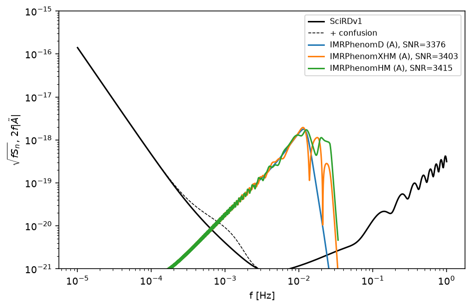
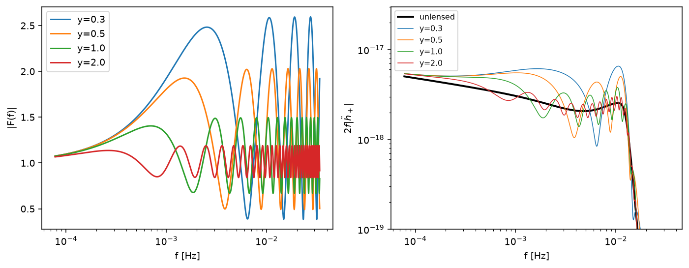
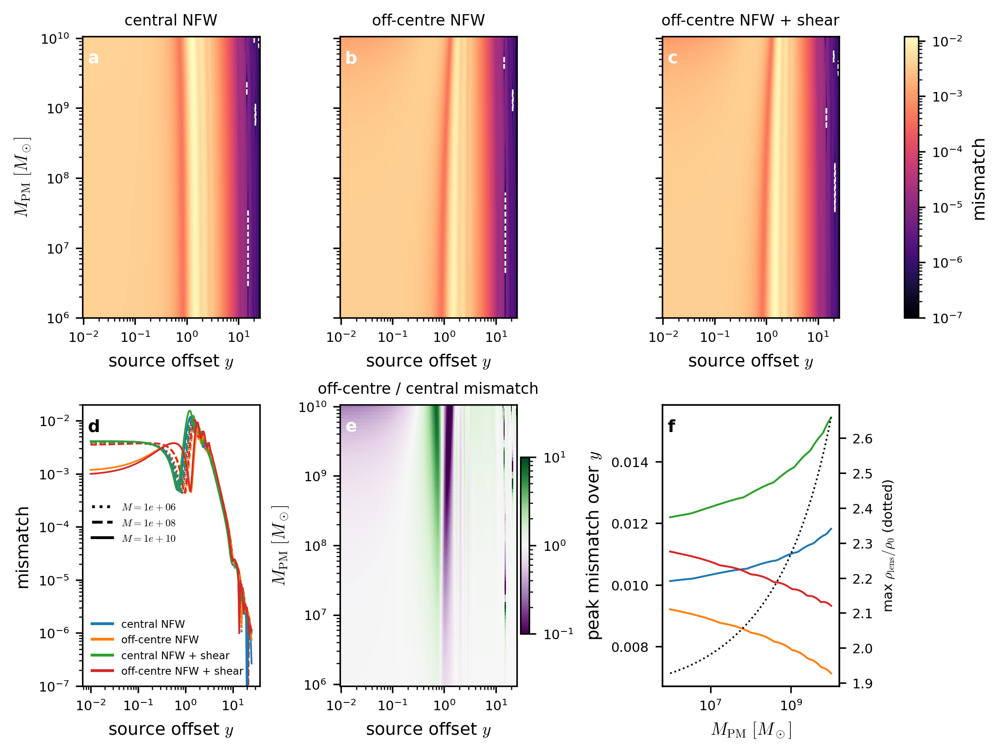
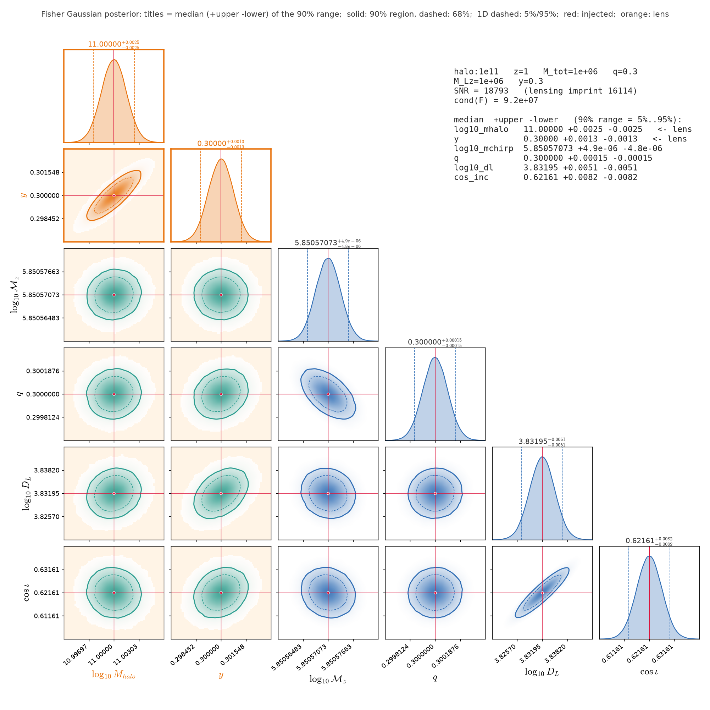

# Gravitational Wave Lensing of LISA Massive Black Hole Binaries by Dark Matter Subhalos

## Overview

This repository studies how wave-optics lensing by dark-matter subhalos imprints on gravitational waves from massive black hole binaries (MBHBs) observed by LISA. Subhalos are modelled as NFW (Navarro-Frenk-White) profiles with a central compact object (a point mass and/or an axion cloud), and the question is whether the composite lens leaves a signature that is distinct from a point-mass lens alone and detectable above LISA instrumental noise.

## Science goal

Lensing of gravitational waves probes the matter distribution of the lens on scales (sub-galactic, dark) that are inaccessible electromagnetically. In the wave-optics regime relevant to LISA sources, the amplification factor F(f) depends on the lens profile, not just its total mass, so a composite NFW + compact-object lens can imprint a frequency-dependent signature that a point mass cannot. The pipeline:

1. generates a LISA MBHB signal (waveform, TDI response, SciRDv1 noise, SNR) and validates it against known results,
2. applies a lens amplification factor F(f) to the signal using [GWLENS](https://github.com/hsreekanth15/GWLENS) (point-mass, NFW and composite lenses),
3. quantifies the effect as a change in SNR and as a mismatch between lensed and unlensed signals, scanned over lens mass and impact parameter.

| Step | Question | Result |
|---|---|---|
| Waveform & SNR (`lisa_mbhb_01_waveform_snr.py`) | Does the TDI model reproduce the expected sky-averaged SNR, and are different waveform approximants consistent? | SNR ≈ 3376-3415 across `IMRPhenomD`/`XHM`/`HM` for a 5×10⁵ + 2.5×10⁵ M<sub>sun</sub> source at z=1; higher-order modes agree with `IMRPhenomD` to ~2% mismatch |
| Lensed SNR scan (`lisa_mbhb_02_lensed_snr.py`) | How much does a point-mass lens change the detected SNR as a function of impact parameter y? | A 10⁷ M<sub>sun</sub> lens nearly doubles the SNR at y=0.3 (6710 vs 3376 unlensed) and the effect falls off smoothly by y=2 |
| Mismatch scan (`lisa_mbhb_03_mismatch.py`) | At what lens mass / impact parameter does lensing become distinguishable from the unlensed signal at this SNR? | Mismatch grows with lens mass and shrinks with y; compared against the ~11-parameter distinguishability threshold at SNR≈3400 |
| Composite lens mismatch (point mass + NFW) | Does a dark-matter subhalo around the central compact object change the mismatch signature, and is it detectable? | Mismatch peaks around y≈1 for all configurations (central/off-centre NFW, with/without shear); the off-centre and shear terms shift the peak by up to ~50% depending on lens mass, within the LISA-detectable region |
| Fisher parameter estimation (`lisa_mbhb/fisher.py`, `scripts/fisher_*.py`) | Given a detection, how precisely can the lens (and source) parameters be recovered, and does a dark-matter halo around the point mass degrade or help that measurement? | Joint MBH + lens Fisher matrix per source/lens configuration, with validation (`fisher_check.py`) and grid scans (`fisher_point.py`, `fisher_plot.py`) over lens mass and impact parameter |






## Repository layout

```
lisa_mbhb/         core package: waveform, LISA response, noise, lensing, overlap/mismatch, inference, sampler
scripts/           step scripts that run the pipeline and produce the figures/results below
tests/             pytest suite checking the package against known analytic/numerical results
figures/           figures and result JSONs produced by the scripts
```

## Installation

```bash
pip install lisa-mbhb
```

or, for development:

```bash
git clone https://github.com/SSingh087/lisa-mbhb.git
cd lisa-mbhb
pip install -e ".[test]"
pytest
```

Requires Python ≥3.11. All dependencies, including [GWLENS](https://github.com/hsreekanth15/GWLENS) (`gwlens` on PyPI), install automatically. To use a local GWLENS checkout instead, point to it with:

```bash
export GWLENS_PATH=/path/to/GWLENS
```

## Lens models

All lensing is computed by the [GWLENS](https://github.com/hsreekanth15/GWLENS) solvers (`Solver1D`, or `Solver2D` for potentials with shear). `lisa_mbhb.lensing` only converts physical units to GWLENS's dimensionless ones (f → w = 8πG M<sub>Lz</sub> f / c³, and M200, z → the NFW ψ₀, x<sub>s</sub>), fixes the solver settings (`solver_kw()`: GWLENS `PE_SETTINGS` and `time_origin=None`, so every lens uses the same time convention as the analytic point mass), and applies F(f) to the LISA signal.

Use any GWLENS potential directly, or a named lens with defaults for the parameters you leave out:

```python
from gwlens.solver import solver1d as S1
from lisa_mbhb import lensing as L

lens = L.Lens(S1.point_mass(1.0) + S1.sis(0.3), y=0.5, mass_lz=1e7)   # any GWLENS potential
lens = L.get_lens("pm")                      # point mass, all defaults (mass_lz=1e7, y=1)
lens = L.get_lens("pm", mass_lz=1e8, y=0.5)  # override some parameters
lens = L.get_lens({"name": "nfw", "halo_mass": 1e11, "zs": 2.0})   # config dict, e.g. from JSON
L.available_lenses()                         # {name: {parameter: default}}

sig = L.LensedMBHB(params, lens={"name": "halo", "halo_mass": 1e9})  # name or config also accepted here
```

| name (aliases) | GWLENS potential | parameters (default) |
|---|---|---|
| `pm` (`point`, `point_mass`) | `point_mass(1)` | `mass_lz` (1e7), `y` (1.0) |
| `nfw` (`pm_nfw`) | `point_mass(1) + nfw(1/x_s, ψ₀)`: point mass at the centre of an NFW halo | `mass_lz` (1e7), `y` (1.0), `halo_mass` (1e11, M200), `zs` (1.0), `zl_frac` (0.5), `conc` (None: c200(M) relation) |
| `halo` (`nfw_only`) | `nfw(1/x_s, ψ₀)`: the halo alone, same units as `nfw` | as `nfw` |
| `sis` | `sis(1)` | `mass_lz` (1e7), `y` (1.0) |
| `cis` | `cis(1, rc)` | `mass_lz` (1e7), `y` (1.0), `rc` (0.05) |

`mass_lz` is the redshifted mass that sets the units (x and y in units of its Einstein radius, the same for every lens, so lenses compare point by point), in M<sub>sun</sub>. ψ₀ = (1+z<sub>L</sub>) M200 / (m(c) M<sub>Lz</sub>), with m(c) = ln(1+c) − c/(1+c). Unknown parameter names raise an error, and the `"nfw:1e9"` / `"halo:1e9"` strings work too. The Fisher study (`lisa_mbhb.fisher_lenses`) builds its PML / NFW / PML+NFW potentials with external convergence and shear the same way, with `Solver2D`. To name your own lens:

```python
@L.register_lens("sis_scaled", dict(mass_lz=1e7, y=1.0, psi0=0.5))
def sis_scaled(mass_lz, y, psi0):
    return L.Lens(S1.sis(psi0), y, mass_lz)
```

## Usage

Each script under `scripts/` is a runnable step of the pipeline and writes its figure and results JSON to `figures/`:

```bash
python scripts/lisa_mbhb_01_waveform_snr.py --approximants IMRPhenomD IMRPhenomXHM
python scripts/lisa_mbhb_02_lensed_snr.py --mass-lz 1e7 --y 0.3 0.5 1.0 2.0
python scripts/lisa_mbhb_03_mismatch.py --mass-lz 3e6 1e7 3e7 --y 0.3 0.5 1 2 3
```

The Fisher scripts (`fisher_point.py`, `fisher_check.py`, `fisher_step_scan.py`, `fisher_plot.py`, `fisher_contours.py`, `fisher_corner.py`, `fisher_table.py`, `fisher_report.py`, `fisher_ppd.py`, `fisher_fig3.py`, `fisher_gridcheck.py`) are cluster/grid-scan drivers built on `lisa_mbhb.fisher`; run `python <script> --help` for their options.

Run `python <script> --help` for the full set of options (source masses, redshift, waveform approximant, output directory).

## Tests

```bash
pytest
```

The suite checks the noise/response implementation against PyCBC's analytical LISA PSDs, the sky-averaged SNR against a Monte-Carlo estimate, the point-mass lens against its analytic geometric-optics limit, and that lensing and mismatch behave as expected (e.g. mismatch decreases with increasing impact parameter).

Lens checks: every solver lens uses the same time convention as the analytic point mass (an NFW lens with a vanishing halo reproduces the point-mass F to 1e-6 in the full complex F), and the NFW normalisation reproduces the halo's M200 from a direct integral of the density.

Reproducibility: `tests/test_reproduce.py` regenerates the waveforms (h+, h× for IMRPhenomD/XHM/HM), TDI SNRs, approximant mismatches, lensed SNRs and F(f) of every lens, and compares them to `tests/data/reference.json` (relative tolerance 1e-9 for waveforms and SNRs) and to the published `figures/*.json`. The reference file records the library versions it was made with. Regenerate it only on purpose, with `python scripts/make_reference.py`.

## Contributors

Ansal Kanu, Sreekanth Harikumar, Shashwat Singh
